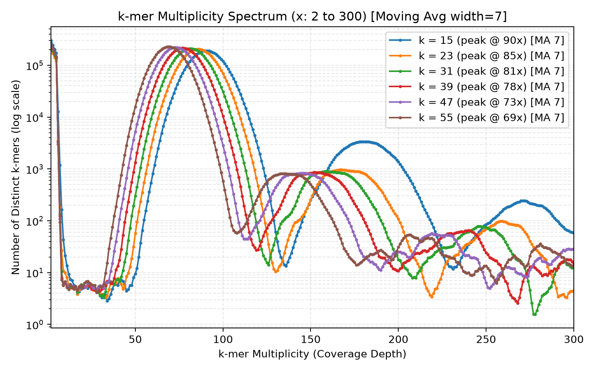

# Reference-Free SNP & Variant Detection in *Salmonella enterica*

An algorithmic toolkit for reference-free de novo detection of single- and multi-nucleotide variations directly from raw Illumina sequencing reads, developed for the **TATFAR Outbreak Investigation** project.

---

### Project Links
- **Project Report**: [Typst Document](https://typst.app/project/wHKXWXZBZi7wGycuX0mvDq)
- **Reference Implementation**: [py-debruijn on GitHub](https://github.com/mitbal/py-debruijn/blob/master/debruijn.py)

---

## Overview

Traditional variant detection relies on aligning reads against a reference genome. However, in bacterial epidemiology and outbreak tracking, reference-based methods suffer from:
1. **Reference bias**: Divergence between the outbreak strain and available reference assemblies leads to unmapped reads in hypervariable or mobile regions.
2. **Structural / accessory genome blindspots**: Plasmids, prophages, and genomic islands carrying resistance genes (e.g. tetracycline resistance *tetR*) may be absent from the reference.
3. **Assembly artifact propagation**: Reference misassemblies cause false-positive SNP calls.

This project implements an end-to-end, reference-free variation discovery pipeline consisting of two tools:
- **`snpDetect.py`**: A reference-free variant caller that discovers SNPs, MNPs, and small indels in linear time $O(N)$ by mining differential solid $k$-mers and resolving local De Bruijn bubbles.
- **`kmerAnalysis.py`**: A statistical spectrum and De Bruijn graph topology analyzer used to determine the mathematically optimal choice of $k$, evaluate error contrast, and export data for iterative plotting.

---

## 1. Variant Detection Algorithm (`snpDetect.py`)

`snpDetect.py` identifies genetic differences between two read sets—**Strain A** (e.g. Wild-Type) and **Strain B** (e.g. Resistant Variant)—without reference genomes or whole-genome de novo assembly.

```
       Strain A Reads                     Strain B Reads
             │                                  │
             ▼                                  ▼
   Canonical k-mer Counter            Canonical k-mer Counter
             │                                  │
             ▼                                  ▼
      Spectrum Filter                    Spectrum Filter
      (Cutoff t_A >= 9)                  (Cutoff t_B >= 9)
             │                                  │
             └───────────────┬──────────────────┘
                             ▼
               Differential Solid k-mers
               - Solid in A, absent in B
               - Solid in B, absent in A
                             │
                             ▼
               Bidirected Contig Chaining
                 (Prefix/Suffix overlap)
                             │
                             ▼
               Flank Matching & Bubble Alignment
              (Left anchor >= 8bp, Right anchor >= 8bp)
                             │
                             ▼
            Variation Calling Report (SNP / MNP / Indel)
```

### Algorithmic Steps

1. **Linear-Time Streaming & Canonical $k$-mer Counting ($O(N)$)**:
   - Reads are streamed in a single pass from FASTA files.
   - Double-stranded sequencing symmetry is enforced by mapping each $k$-mer $s$ to its canonical representation:
     $$\text{canonical}(s) = \min(s, \text{reverse\_complement}(s))$$
   - Counting canonical $k$-mers ensures strand-neutral frequency estimation without inflating memory usage.

2. **Adaptive Coverage Cutoff ($t$) via Spectrum Trough Detection**:
   - Illumina sequencing errors ($\approx 1\%$ substitution rate) generate erroneous $k$-mers that appear at low frequencies ($1\times, 2\times$).
   - Real genomic $k$-mers form a Poisson-like distribution around the true sequencing depth (e.g. $70\times$–$90\times$).
   - The tool dynamically locates the valley/trough $t$ between the error peak and the single-copy genomic peak to filter out sequencing noise.

3. **Mining Differential Solid $k$-mers**:
   - Solid $k$-mers specific to Strain A are identified:
     $$D_A = \{ m \in K_A \mid \text{count}_A(m) \ge t_A \text{ and } \text{count}_B(m) \le e \}$$
   - Solid $k$-mers specific to Strain B are identified:
     $$D_B = \{ m \in K_B \mid \text{count}_B(m) \ge t_B \text{ and } \text{count}_A(m) \le e \}$$
   - Setting $e = 1$ tolerates rare sequencing errors occurring in the opposite strain.
   - A single point mutation creates a "bubble" of exactly $k$ mutated canonical $k$-mers spanning the locus.

4. **Bidirected Contig Chaining**:
   - Rather than constructing a massive whole-genome De Bruijn graph, an overlap adjacency index is built strictly over the small subset of differential $k$-mers ($D_A$ and $D_B$).
   - $k$-mers sharing $(k-1)$ prefixes and suffixes are greedily assembled into contiguous local contigs flanking the mutation site.

5. **Flank Matching & Variant Calling**:
   - Assembled local contigs from Strain A and Strain B are aligned by matching identical flanking anchors (minimum 8 bp left prefix and right suffix).
   - The divergent core sequence between the matching anchors is extracted and classified:
     - **SNP**: Single Nucleotide Polymorphism (e.g. `[A]` $\to$ `[G]`)
     - **MNP**: Multi-Nucleotide Polymorphism / codon substitution (e.g. `[TTT]` $\to$ `[GGG]`)
     - **Indel**: Insertion or deletion event
   - Reports forward and reverse-complement genomic context alongside average read depth.

---

## 2. Parameter Optimization & Spectrum Analysis (`kmerAnalysis.py`)

The sensitivity and accuracy of reference-free variant detection depend on the choice of $k$:
- **If $k$ is too small**: Random collisions occur ($4^k \le G$), and repetitive genomic sequences (e.g. rRNA, insertion sequences) fail to resolve, creating tangled De Bruijn graph branching.
- **If $k$ is too large**: The fraction of error-free reads decays exponentially as $(1 - \epsilon)^k$, and effective $k$-mer coverage drops according to $C_k = C \frac{L - k + 1}{L}$.

`kmerAnalysis.py` evaluates candidate $k$ values against four criteria:

1. **Information-Theoretic Lower Bound**:
   $$k_{\min} = \lceil \log_4(G) \rceil$$
   For the *Salmonella enterica* genome ($G \approx 4.8 \times 10^6$ bp), $k_{\min} = 12$.
2. **Multiplicity Spectrum Contrast**:
   - Evaluates the contrast ratio $R = \frac{\text{freq}(t)}{\text{freq}(\text{peak})}$. A low ratio ($R < 0.05$) signifies clean separation between sequencing noise and the true bacterial genome.
3. **De Bruijn Graph Linearity & Repeat Resolution**:
   - Samples $(k-1)$-mer nodes and evaluates vertex degrees:
     - **Linear Nodes** ($\text{in-degree} = 1, \text{out-degree} = 1$): Unambiguous linear paths.
     - **Branching Nodes** ($\text{in-degree} > 1 \text{ or } \text{out-degree} > 1$): Repetitive elements or sequence ambiguity.
   - Higher $k$ resolves repeats shorter than $k$, driving linearity up and branching down.
4. **Solid Genomic Coverage**:
   - Verifies that the total distinct solid $k$-mers match the expected bacterial genome size ($\approx 4.8$–$4.9$ Mbp).

---

## Multiplicity Spectrum Visualizations

Below is the multiplicity spectrum across candidate values of $k$ ($15, 23, 31, 39, 47, 55$) generated from *Salmonella enterica* sequencing data:



### Summary Comparison Table

| $k$ | Cutoff ($t$) | Peak Depth | Error Types % | Solid $k$-mers | Graph Linearity % | Branching % | Valley Contrast |
|---|---|---|---|---|---|---|---|
| **15** | 14 | 90x | 77.8% | 4,797,111 | 1.7% | 0.1% | 0.0000 |
| **23** | 14 | 85x | 83.3% | 4,901,421 | 1.6% | 0.0% | 0.0000 |
| **31** | 9  | 81x | 86.0% | 4,908,433 | 1.6% | 0.0% | 0.0000 |
| **39** | 9  | 78x | 87.8% | 4,912,992 | 1.6% | 0.0% | 0.0000 |
| **47** | 9  | 73x | 89.0% | 4,916,328 | 1.6% | 0.0% | 0.0000 |
| **55** | 9  | 69x | 89.9% | 4,919,136 | 1.6% | 0.0% | 0.0000 |

*Recommendation:* $k = 31$ or $k = 47$ offers an optimal trade-off between repeat resolution, high coverage depth ($>70\times$), and minimal sequencing error decay.

---

## CLI Usage Guide

### Prerequisites
The project requires Python 3.8+ with `matplotlib`, `tqdm`, and optionally `pandas`:
```bash
conda activate cb
# or: pip install matplotlib tqdm pandas
```

### 1. Running $k$-mer Spectrum Analysis (`kmerAnalysis.py`)
Run the full spectrum analysis, evaluate multiple $k$ values, extend the x-axis to $300\times$, and export the results to a DataFrame CSV:
```bash
python ./salmonella-project/kmerAnalysis.py \
  ./salmonella-project/data/salmonella-enterica/salmonella-enterica.reads.fna \
  --k-list 15,23,31,39,47,55 \
  --min-x 2 \
  --max-x 300 \
  --output-df ./salmonella-project/kmer_spectrum_df.csv \
  -o ./salmonella-project/kmer_spectrum_plot.png
```

### 2. Fast Iterative Re-plotting from Saved DataFrame
Because counting $k$-mers across millions of reads takes $\sim 25$ minutes, you can iteratively tune plot ranges and apply moving average smoothing in $< 1$ second directly from the saved CSV:
```bash
python ./salmonella-project/kmerAnalysis.py \
  --plot-from-df ./salmonella-project/kmer_spectrum_df.csv \
  --min-x 2 \
  --max-x 300 \
  --moving-average 5 \
  -o ./salmonella-project/kmer_spectrum_custom.png
```

**Key CLI Options for `kmerAnalysis.py`:**
- `--max-x / --x-max <int>`: Upper limit of coverage multiplicity on the x-axis (default: `150`).
- `--min-x / --x-min <int>`: Lower limit of coverage multiplicity (default: `1`; set to `2` to exclude the huge error peak at $1\times$).
- `--moving-average / --smooth [WIDTH]`: Apply centered moving average smoothing with the specified window width (default width: `5`).
- `--output-df <path.csv>`: Path to export spectrum counts per $k$ as a CSV.
- `--plot-from-df <path.csv>`: Re-plot directly from an existing DataFrame CSV without re-counting reads.

### 3. Detecting Variants (`snpDetect.py`)
Detect mutations between two bacterial datasets:
```bash
python ./salmonella-project/snpDetect.py \
  ./salmonella-project/data/salmonella-enterica/wild_type.reads.fna \
  ./salmonella-project/data/salmonella-enterica/variant.reads.fna \
  -k 31 \
  -o ./salmonella-project/snps_output.txt
```

**Key CLI Options for `snpDetect.py`:**
- `-k, --kmer <int>`: $k$-mer length (default: `31`).
- `-m, --max-reads <int>`: Read subsampling limit for fast testing.
- `-c, --min-coverage <int>`: Explicit coverage cutoff (default: auto-detected from spectrum trough).
- `-e, --max-error <int>`: Maximum occurrences tolerated in opposite strain (default: `1`).
- `-o, --output <path>`: File to save the variation report.

### 4. Running the Test Suite
Validate the pipeline against synthetic genomes, simulated Illumina errors, and reverse-complement neutrality:
```bash
python ./salmonella-project/test_snp_detect.py
```

---

## Repository Structure

```
salmonella-project/
├── kmerAnalysis.py               # Spectrum analysis, optimal k selection & DataFrame export
├── snpDetect.py                  # Reference-free de novo SNP/MNP/Indel caller
├── test_snp_detect.py            # Unit tests & error simulation benchmarks
├── kmer_spectrum_df.csv          # Exported k-mer spectrum counts DataFrame
├── kmer_spectrum_custom.png      # Multiplicity spectrum plot (MA-smoothed, x: 2-300)
├── kmer_spectrum_15_55_full.txt  # Console output from deep sequencing analysis
├── snps_output.txt               # Sample mutation calling report
├── README.md                     # Project documentation & algorithm guide
└── data/                         # Raw sequencing reads (FASTA format)
```
